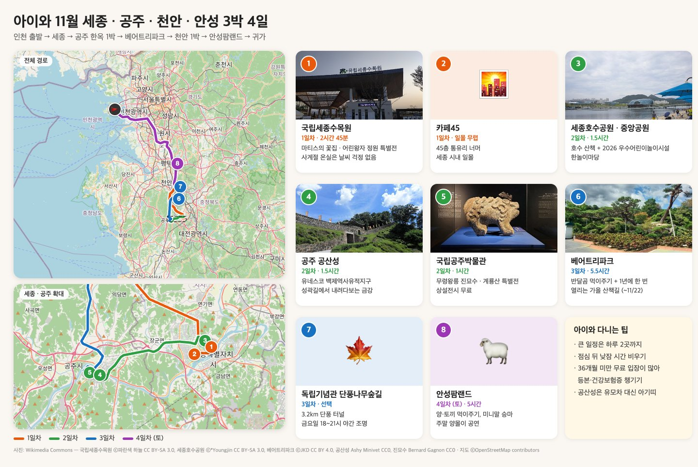

# 아이와 11월 세종·공주·천안·안성 3박 4일

수도권(인천)에서 출발해 **세종 → 공주 한옥 1박 → 베어트리파크 → 천안 1박 → 안성팜랜드**를 도는 3박 4일 코스입니다. 3살 아이 기준으로 **큰 일정은 하루 2곳까지, 점심 뒤에는 낮잠 시간**을 비웠습니다. 1일차는 수요일, 4일차는 토요일 기준입니다. 평일인지 주말인지에 따라 열리는 프로그램이 다르기 때문입니다.

| 일차 | 일정 | 숙박 |
|---|---|---|
| 1일차 (수) | 국립세종수목원 → 카페45 일몰 | 세종 |
| 2일차 (목) | 중앙공원 놀이터·호수공원 → 공산성 → 제민천 카페 → 공주한옥마을 → 국립공주박물관 | 공주한옥마을 |
| 3일차 (금) | 베어트리파크 하루 (+ 선택: 독립기념관 단풍나무숲길) | 천안 |
| 4일차 (토) | 안성팜랜드 하루 → 귀가 | – |

- 이동시간은 정체를 뺀 경로 계산값입니다. 실제로는 1.2~1.5배로 잡는 게 안전합니다.
- 식당 평점(★)과 리뷰 수는 2026-11-08 기준 네이버 플레이스 방문자 리뷰입니다. "비공개"는 가게가 별점을 숨긴 경우입니다.
- 어른 5명 이상에 카시트까지 실어야 하면 **7인승 이상 차**가 필요합니다.

---

## 1일차 (수) — 세종

| 시간 | 일정 |
|---|---|
| 08:30 | 인천 출발 (세종까지 약 2시간 20분) |
| 11:30–12:30 | 점심 (세종 나성동) |
| 13:00–15:45 | 국립세종수목원 |
| 16:00–16:50 | 숙소 체크인, 휴식 |
| 16:50–18:00 | 카페45에서 일몰 (17:25) |
| 18:00–19:00 | 저녁 (나성동) |

### 점심 — 세종 나성동

| 식당 | 메뉴 | ★ | 방문 리뷰 | 블로그 | 가격대 | 유아의자 |
|---|---|---|---|---|---|---|
| [동동칼국수 세종나성점](https://map.naver.com/p/entry/place/1816368610) | 칼국수·만두 | 비공개 | 7,616 | 385 | 1만원대 | – |
| [돔베초밥](https://map.naver.com/p/entry/place/1916763306) | 초밥·롤 | 4.61 | 2,968 | 612 | 2만원대 | O |
| [라라코스트 세종나성점](https://map.naver.com/p/entry/place/1107285372) | 패밀리레스토랑 | 비공개 | 2,976 | 165 | 2만원대 | O |

### 국립세종수목원 — 2시간 45분

- **소요시간**: 3살 기준 블로그 예시가 약 2시간이었습니다(발권 → 온실 45분 → 정원 1곳 30분 → 휴식). 특별전이 2개 있어서 늘려 잡았습니다.
- **이 시기 포인트**
  - 특별전시온실 「어린왕자의 지구여행: 공존, 모두의 정원」(~2027-05-09)과 지중해온실 「마티스의 꽃집」(~12/31)을 합니다.
  - 「나무랄 데 없는 예술가」 공연이 11/14까지 열립니다.
  - 충청권 단풍 절정 예측이 10/28~11/8이라 11월 중순엔 바깥 단풍은 끝물입니다.
- **운영**: 11~2월은 화~일 09:00~17:00이고 **입장 마감은 16:00**입니다. 월요일은 휴관입니다.
- **요금**: 어른 5,000원입니다. **만 6세 이하·65세 이상은 무료**인데, 증빙을 가지고 유인매표소에서 발권해야 합니다. 주차는 무료입니다.
- **추천 동선**: 사계절전시온실(45분) → 특별전시온실(30분) → 온실 카페에서 간식(25분) → 바깥 정원 1곳(30분)
- **반입 금지**: 과일·국물 음식, 킥보드·자전거, 전동 완구
- **식음료**: 한울라운지 11:00~17:00, 아이에떼 커피 09:30~17:00

### 카페45 — 일몰

- 나성동 나릿재마을 601동 45층에 있는 스카이라운지입니다. 영업은 11:00~23:00입니다.
- **소요시간**: 11월 중순 세종 일몰은 17:25 무렵이고 시민박명은 17:52에 끝납니다. 16:50쯤 도착해 창가 자리를 잡으면 됩니다.
- 노키즈존 표기는 없고 유아의자가 있다는 후기가 있습니다. 아이와 간다면 가기 전에 전화로 확인하세요.
- 6단지 상가 주차장에 세우고 **스카이라운지 전용 엘리베이터**를 타야 합니다. 입구가 두 곳이라 헷갈리기 쉽습니다.
- 아메리카노 6,000원, 파스타 1.9만원대, 피자 2.3~2.5만원대입니다.

### 저녁 — 나성동 (카페45에서 500m 안)

| 식당 | 메뉴 | ★ | 방문 리뷰 | 블로그 | 가격대 | 유아의자 |
|---|---|---|---|---|---|---|
| [광화문미진 세종점](https://map.naver.com/p/entry/place/1801918817) | 메밀국수 한식 | 4.77 | 4,875 | 1,040 | 2만원대 | O |
| [비스트로 앤 나성점](https://map.naver.com/p/entry/place/1930245543) | 이탈리안 | 4.85 | 3,322 | 511 | 5만원대 | O |
| 카페45 | 파스타·피자 | 비공개 | 801 | – | 2만원대 | 후기상 있음 |

### 세종 숙소 후보

- 베스트웨스턴 플러스 호텔 세종(어진동): 온돌·온돌 스위트 객실이 있습니다.
- 코트야드 메리어트 세종(어진동): 이그제큐티브 스위트와 커넥팅룸이 있습니다.
- 세종컨벤션센터스테이(어진동): 호수공원과 가깝습니다.

---

## 2일차 (목) — 세종 오전 → 공주

목요일이라 **공주 고마열차(유적지 순환열차)와 공산성 수문병 교대식은 없습니다.** 둘 다 주말에만 운영합니다.

| 시간 | 일정 |
|---|---|
| 09:15–10:45 | 중앙공원 한놀이마당 + 세종호수공원 |
| 10:45 | 공주로 이동 (20분) |
| 11:15–12:15 | 점심 (공산성 앞) |
| 12:30–14:00 | 공산성 |
| 14:00–14:45 | 제민천 밤 디저트 카페 |
| 15:00–16:30 | 공주한옥마을 체크인 + 낮잠 |
| 16:45–17:45 | 국립공주박물관 |
| 18:00 | 저녁 |

### 중앙공원 한놀이마당 + 세종호수공원 — 1.5시간

- 3살이 놀 곳은 호수공원 바로 옆 **중앙공원 한놀이마당**입니다. 조합놀이대, 그네, 모래놀이터, 트램펄린이 있고 2026년 행정안전부 우수어린이놀이시설로 선정됐습니다. 호수공원 안 놀이마당에는 짚라인만 있습니다.
- 11월에는 호수공원 물놀이섬이 운영을 마쳤고, 행복폭포·경관수로는 수선 중이라 쓸 수 없습니다.

### 점심 — 공산성 앞 (0.5~0.7km)

| 식당 | 메뉴 | ★ | 방문 리뷰 | 블로그 | 가격대 | 유아의자 |
|---|---|---|---|---|---|---|
| [공산성본가](https://map.naver.com/p/entry/place/37293732) | 갈비탕 | 4.59 | 1,293 | 381 | – | O |
| [고마나루1999](https://map.naver.com/p/entry/place/38223276) | 솥밥 한식 | 4.39 | 1,509 | 575 | 5만원대 | – |
| [광장순대](https://map.naver.com/p/entry/place/1746554262) | 순대국밥·수육 | 4.62 | 285 | 155 | 2만원대 | – |

### 공산성 — 1.5시간

- **소요시간**: 성곽 둘레가 2.6km라 3살에게 다 돌기는 무리입니다. **금서루 → 공북루(금강 전망) → 쌍수정 방향으로 일부만 걷고 되돌아오는** 기준으로 잡았습니다.
- **이 시기 포인트**: 백제문화제와 공산성 미디어아트는 10월에 끝나서 행사가 없습니다. 대신 덜 붐빕니다.
- **운영**: 11~2월은 09:00~17:00이고 입장은 16:30까지입니다. 주차는 무료입니다.
- **요금**: 어른 3,000원, 어린이 1,000원입니다.
- **유모차는 거의 못 씁니다.** 좁고 경사진 성곽길에 난간 없는 구간이 있으니 아기띠나 힙시트를 챙기세요.

### 제민천 밤 디저트

- 베이커리 밤마을: 밤파이. 2층 창으로 공산성이 보입니다.
- 바므: 한옥 카페, 밤 아이스크림
- 체스넛프렌즈: 왕밤빵

### 공주한옥마을

- 공주시가 운영하는 한옥 숙소로, 모든 객실이 구들 온돌입니다. 체크인 15:00, 체크아웃 11:00입니다.
- **5일 전까지 취소해야 전액 환불**됩니다. 객실 안에서는 취사가 안 됩니다.
- 패밀리 온돌은 주중 13만 원(기준 4명, 최대 8명)이고, 6인 이상이면 방 3개짜리 주니어·로얄 스위트가 있습니다.
- 마을 안에 전통놀이방(무료)과 백제 복식 체험(3살 사이즈 있음)이 있습니다.

### 국립공주박물관 — 1시간

- **이 시기 포인트**: 특별전 「한국의 영산, 계룡산」(무료, ~2027-03-01)을 합니다.
- 09:00~18:00 운영, 상설전시 무료, 월요일 휴관입니다. 한옥마을 바로 옆이라 체크인하고 낮잠 잔 뒤 가기 좋습니다.
- 무령왕릉 유물과 진묘수가 아이에게 볼거리입니다. 어린이 체험실은 온라인으로 예약해야 합니다.

### 저녁 — 한옥마을 근처

| 식당 | 메뉴 | ★ | 방문 리뷰 | 블로그 | 가격대 | 거리 | 유아의자 |
|---|---|---|---|---|---|---|---|
| [공주시민해물손칼국수](https://map.naver.com/p/entry/place/1676402773) | 해물칼국수·수육 | 4.78 | 1,061 | 370 | 2만원대 | 1.1km | O |
| [영빈관](https://map.naver.com/p/entry/place/1047676475) (한옥마을 안) | 소불고기 한정식 | 비공개 | 199 | 229 | 7만원대 | 0.1km | – |
| [올리브페페](https://map.naver.com/p/entry/place/1098471604) | 파스타·리조또 | 4.90 | 998 | 46 | – | 2.7km | O |

---

## 3일차 (금) — 베어트리파크 하루

| 시간 | 일정 |
|---|---|
| 09:15 | 한옥마을 체크아웃 (베어트리까지 35분) |
| 10:00–12:00 | 곰동산 → 오색연못 → 애완동물원 |
| 12:00–13:00 | 점심 (공원 안) |
| 13:00–14:30 | 가을 산책길 |
| 14:30–15:30 | 열대온실·분재원 → (선택) 전망대 |
| 15:30 | 천안 숙소로 이동 (약 30분) |
| 17:30 | 저녁 |

### 세종 베어트리파크 — 5.5시간

- **소요시간**: 공식 안내는 관람 2~3시간입니다. 10만 평 규모라 곰·잉어 먹이주기, 가을 산책길, 점심, 쉬는 시간을 더했습니다.
- **이 시기 포인트**: 가을축제 '시간의 정원'이 10/3~11/22에 열립니다. **가을 산책길(09:00~17:00)은 1년에 이 기간에만 엽니다.** 단풍 절정 예측이 10/24~11월 초라 11월 중순엔 낙엽길일 가능성이 큽니다.
- **요금**: 성인 13,000원, 어린이(36개월~초등) 9,000원입니다. **36개월 미만은 의료보험증을 내면 무료**입니다.
- 유모차 대여는 **24개월 미만만** 되니 집에서 챙겨 가세요.
- 외부 음식은 반입할 수 없습니다. 음료와 이유식만 예외이고, 입구 피크닉장에서는 먹을 수 있습니다.
- 곰 먹이는 곰동산 입구에서 1,000원에 팝니다. 비단잉어는 겨울에 월동 장소로 옮긴다는 기사가 있으니 현장에서 확인하세요.

### 점심 — 공원 안

| 식당 | 메뉴 | ★ | 방문 리뷰 | 블로그 | 가격대 | 유아의자 |
|---|---|---|---|---|---|---|
| 레스토랑 베어트리 (베어트리하우스 2층) | 스테이크·피자·돈가스 | 비공개 | 580 | 23 | 7만원대 | – |
| [카페 베어트리](https://map.naver.com/p/entry/place/17736425) | 음료·가벼운 식사 | 4.59 | 85 | 13 | 1만원대 | O |
| 입구 피크닉장 도시락 | – | – | – | – | – | – |

- 레스토랑 베어트리의 평점·리뷰 수는 공원과 주소가 같은 네이버 '웰컴레스토랑' 항목의 값입니다.
- 공원 밖에서 먹으려면 입장 전에 [야호래](https://map.naver.com/p/entry/place/1819638410)(메밀싹 비빔밥, ★4.74, 리뷰 2,040, 유아의자 있음)가 1.9km 거리입니다.

### 저녁 — 천안 목천

| 식당 | 메뉴 | ★ | 방문 리뷰 | 블로그 | 가격대 | 유아의자 |
|---|---|---|---|---|---|---|
| [목천장 독립기념관 목천본점](https://map.naver.com/p/entry/place/1554952851) | 한식 | 4.88 | 1,047 | 296 | 2만원대 | O |
| [웅짜장 본점](https://map.naver.com/p/entry/place/1238214720) | 짜장·짬뽕 | 4.91 | 1,094 | 508 | 2만원대 | O |
| [오미오미 수제만두전골](https://map.naver.com/p/entry/place/1629046337) | 손만두전골 | 비공개 | 3,986 | 905 | 2만원대 | – |

### 천안 숙소 후보

- 소노벨 천안: WEST동 스위트는 최대 8인이고 취사가 됩니다. 실내외 워터파크가 있습니다.
- 천안 상록리조트: 콘도형 객실이 있습니다.

### (선택) 독립기념관 단풍나무숲길

- 방화도로 양쪽에 1997년부터 심은 단풍나무가 3.2km 터널을 이룹니다. 2024년 기사에 "11월 중순 단풍 터널과 낙엽이 장관"이라고 나옵니다.
- 2026년 단풍나무숲길 힐링축제는 10/16~11/15 금·토·일 18:00~21:00 야간개장(조명, 미디어파사드, 푸드트럭)입니다. 공연과 체험은 토·일에만 합니다.
- 야간개장은 2023년에 시작한 행사라 실제 방문 후기가 많지 않습니다. 3살과 함께라면 **낮(09:30~17:00, 유모차 대여 15:00까지)**에 가는 쪽이 낫습니다.

---

## 4일차 (토) — 안성팜랜드 하루

| 시간 | 일정 |
|---|---|
| 10:00–11:30 | 먹이주기(건초·토끼·새모이), 미니말 승마 |
| 11:30 | 가축놀이한마당 |
| 12:00–13:00 | 점심 |
| 13:00 | 가축장기자랑 |
| 13:30–15:00 | 핑크뮬리 산책, 방방, 놀이기구 |
| 15:00 | 양몰이 |
| 15:30 | 귀가 |

### 안성팜랜드 — 5시간

- **소요시간**: 2021년 축제 안내에 관람 5~6시간으로 나옵니다. 주말 공연 시간에 맞춰 잡았습니다.
- **이 시기 포인트**: 주말 가축 공연(11:30·13:00·15:00·16:00·16:30)을 합니다. 11/7 공지 기준으로 핑크뮬리가 남아 있습니다.
- **요금 (11월 주말)**: 입장 대인 13,000원·소인 11,000원, 입장+승마 대인 20,000원입니다. **36개월 미만은 증빙을 내면 무료**입니다.
- **미니말 승마(8,000원)는 미취학 아동 대상**입니다. 체험승마와 놀이기구는 36개월 이상이고, 말 점심시간인 12~13시엔 승마를 쉽니다.
- 먹이는 건초·토끼먹이 각 2,000원, 새모이 1,000원입니다. 외부 먹이는 반입할 수 없습니다.

### 점심

| 식당 | 메뉴 | ★ | 방문 리뷰 | 블로그 | 가격대 | 거리 | 유아의자 |
|---|---|---|---|---|---|---|---|
| [임실치즈피자 안성팜랜드점](https://map.naver.com/p/entry/place/1730948704) | 피자 | 비공개 | 508 | 26 | – | 팜 안 | – |
| [북극해고등어 안성공도점](https://map.naver.com/p/entry/place/1914666432) | 생선구이 | 4.85 | 1,635 | 153 | 2만원대 | 1.7km | O |
| [훗스테이크 안성점](https://map.naver.com/p/entry/place/2056436944) | 스테이크·파스타 | 4.85 | 3,110 | 603 | 3만원대 | 2.7km | O |

- 아이가 일찍 지치면 13:00 공연까지만 보고 나와서 공도에서 점심을 먹고 귀가하면 됩니다.
- 시간이 남으면 근처 안성맞춤랜드의 **남사당 바우덕이 상설공연**(4~11월 토·일 14:00, 만 4세 이하 무료)도 볼 수 있습니다.

---

## 챙길 것

- 유모차: 베어트리파크는 24개월 미만만 대여됩니다.
- 아기띠나 힙시트: 공산성 성곽길에서 필요합니다.
- 등본이나 건강보험증: 36개월 미만 무료 입장 증빙용입니다(베어트리파크, 안성팜랜드). 수목원 무료 발권에도 증빙이 필요합니다.
- 겨울 외투, 담요, 핫팩

## 참고

- [국립세종수목원 이용안내](https://sjna.koagi.or.kr/sjna/viewngGdnc/useGdnc.jsp)
- [공산성 (공주시)](https://www.gongju.go.kr/prog/tursmCn/tour/sub06_04/view.do?cntno=14) · [공주한옥마을](https://www.gongju.go.kr/hanok/) · [국립공주박물관](https://gongju.museum.go.kr/kor/)
- [베어트리파크 이용안내](https://www.beartreepark.com/information)
- [안성팜랜드 요금](https://www.nhasfarmland.com/new/use/use02.php) · [주말 이벤트](https://www.nhasfarmland.com/new/comm/comm01.php?ptype=view&idx=7220&page=1&code=notice)
- [독립기념관 단풍나무숲길 힐링축제 공지](https://i815.or.kr/2018/news/news.do?mode=V&no=997450&key_bbs_cd=news)
- [남사당 바우덕이 상설공연](https://www.anseong.go.kr/tourPortal/namsadang/contents.do?mId=0403000000)
- 사진: Wikimedia Commons (국립세종수목원 ⓒ파란색 하늘 CC BY-SA 3.0, 세종호수공원 ⓒ*Youngjin CC BY-SA 3.0, 베어트리파크 ⓒJKD CC BY 4.0, 공산성 Ashy Minivet CC0, 진묘수 Bernard Gagnon CC0), 지도 ⓒOpenStreetMap contributors
